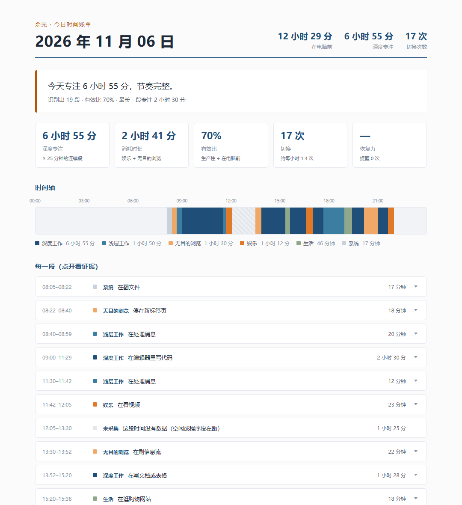

# 余光 · FocusPet

> 一个"用余光看着你"的桌面小工具：不录屏、不上传、不评判。
> 白天在你跑偏时轻轻戳一下，晚上给你一张诚实的时间账单。

Windows 桌面端，Python 实现。记录你实际在用什么窗口，用规则（可选视觉模型）判断你在做什么，
在你偏离目标太久时用一只小桌宠提醒，并在晚上生成一张可追溯的时间轴日报。



---

## 它是什么，不是什么

**是**：一个给自己用的行为记录工具。解决一个很具体的认知缺口——
「我知道今天没干什么正事，但不知道具体是哪几个小时、被什么事、切成了多少段」。

**不是**：

- 不是员工监控 / 家长管控软件。**请不要装到别人的电脑上**，性质完全不同。
- 不做全量录屏。只按 10 分钟一张的频率截图，且敏感窗口连标题都不记。
- 不上传任何数据。截图、数据库、报表全在本机。

---

## 功能

| 模块 | 说明 |
|---|---|
| 采集 | 每 5 秒记前台窗口（标题/进程），每 10 分钟截一张图，dHash 去重，敏感应用跳过 |
| 分析 | 46 条 YAML 规则（零成本）优先；只有规则认不出的段才交给视觉模型 |
| 聚合 | 把碎片合成人类可读的时间块，补灰段表示断档，绝不插值 |
| 提醒 | 六道门全过才提醒（目标 → 豁免 → 消耗类 → 置信度 → 持续 3 分钟 → 冷却），L1–L4 分级 |
| 日报 | 每天 22:00，一句话结论 + 指标 + 时间轴 + 可点开的证据 |
| 周报/月报 | 每周日 21:00 / 每月最后一天 21:00，从时间块汇总，带与上周期对比 |
| 桌宠 | 菊鸳动作包（webp 逐帧）；显示层级可选「始终置顶 / 只在桌面显示 / 不显示」；跑偏时探头说话，专注够久时也会夸一句 |

---

## 快速开始

需要 Python 3.11+（开发环境是 3.12）和 Windows 10/11。

```powershell
# 在仓库根目录（有 focuspet/ 这一层）执行，别 cd 进 focuspet/
python -m venv .venv
.venv\Scripts\activate
pip install -r focuspet\requirements.txt

# 1) 先看效果：造一天演示数据，生成示例日报（不碰你的屏幕，不写真实库）
python -m focuspet --demo

# 2) 只采一次，验证能读到你的窗口
python -m focuspet --once

# 3) 正式跑：托盘 + 桌宠
python -m focuspet
```

> `python -m focuspet` 必须在**仓库根目录**执行。`cd focuspet` 之后再跑会报
> `No module named focuspet`——这个包的名字就是 `focuspet`，得让它在模块搜索路径的第一层。

**用起来只需要记住一件事**：托盘右键 →「开始专注…」写一句今天要干什么。
没有目标声明，它只统计时长、不判断是否跑偏——这是设计上的硬规则，不是 bug。

### 做成桌面快捷方式（不想每次开命令行）

```powershell
$pythonw = (Resolve-Path ".venv\Scripts\pythonw.exe").Path      # pythonw：不弹黑框
$shell = New-Object -ComObject WScript.Shell
$lnk = $shell.CreateShortcut("$env:USERPROFILE\Desktop\余光.lnk")
$lnk.TargetPath = $pythonw
$lnk.Arguments = "-m focuspet --panel"                          # 启动并打开控制面板
$lnk.WorkingDirectory = (Get-Location).Path                     # 必须是仓库根
$lnk.IconLocation = "$PWD\focuspet\assets\icon.ico"
$lnk.Save()
```

> 如果仓库路径里有中文，Windows 的 Shell 可能读不到这个 `.ico`（快捷方式显示成空白图标）——
> 把图标复制到纯英文目录再引用即可，不影响程序本身。
> 开机自启：`.venv\Scripts\python.exe focuspet\scripts\autostart.py install`

### 配视觉模型（可选，不配也能用）

不配时全部由 46 条规则判断，零成本、不联网。想让规则认不出的窗口也能分类，就接一个
支持图片输入的 OpenAI 兼容模型（示例是免费的智谱 GLM-4V-Flash）：

```powershell
setx FOCUSPET_KEY "你的key"      # 写进用户环境变量，不用每次开终端
```

然后改 `focuspet/config.yaml`：

```yaml
analyze:
  mode: cloud
  endpoint: "https://open.bigmodel.cn/api/paas/v4"
  model: "glm-4v-flash"
  max_tokens: 1024               # GLM-4V 系列上限就是 1024
```

改完**重启程序**。两个容易踩的点：用 `setx` 而不是 `$env:`（从快捷方式启动的进程读不到
当前终端里的临时变量）；key 只走环境变量，不要写进 `config.yaml`（那个文件虽然被 gitignore，
但手滑 `git add -f` 就进历史了）。

其它命令：

```powershell
python -m focuspet --headless          # 无界面常驻
python -m focuspet --report            # 生成并打开今天的日报
python -m focuspet --weekly            # 生成并打开本周周报
python -m focuspet --monthly           # 生成并打开本月月报
python -m focuspet --duration 60       # 跑 60 秒自检后退出
```

---

## 工作原理

```
每 5 秒    前台窗口（标题 + 进程）  ──►  sample 表        ← 永远记，零成本
每 10 分钟 截屏 → 去重 → JPEG 1280 ──►  data/shots/       ← 可失败，不影响元数据
每 1 分钟  规则分类（未配模型时）  ──►  analysis 表       ← 本地计算，不联网
每次分析后 段合并、补灰段          ──►  block 表          ← 日报/周报的唯一数据源
每天 22:00 汇总成 HTML             ──►  reports/YYYY-MM-DD.html
```

三个刻意的设计取舍：

1. **元数据优先、截图兜底**。窗口标题和进程名几乎零成本，准确率还高；截图只在需要时补位。
2. **先有目标，才有"摸鱼"**。"摸鱼"是关于意图的判断，没有参照物就只能做分类。
3. **宁可漏报，不可误报**。判定链"全否才退出"；误报一次用户就会关掉提醒。

---

## 仓库结构

```text
focuspet/            程序本体（下面的目录都在这一层里）
├─ capture/          窗口探针、截图、SQLite
├─ analyze/          规则表、模型客户端、批次调度、聚合
├─ judge/            判定链、分级干预、文案
├─ report/           日报 / 周报 / 月报模板与渲染
├─ ui/               托盘、桌宠、设置面板
└─ config/rules.yaml 46 条分类规则（改规则不用改代码）

content/             设计文档的 Markdown 源文
build_doc.py         把 content/*.md 渲染成 Word
make_diagrams.py     用 Pillow 画文档里的示意图
HANDOFF.md           项目交接：现状、坑、下一步
余光_流程_大纲_设计方案_v1.1.docx   完整设计文档（40 页）
大纲.docx            最原始的三段构想
```

想看设计文档的源文改文字，改 `content/*.md` 后跑 `python build_doc.py`；
想改判定规则，直接改 `focuspet/config/rules.yaml`，不用碰代码。

---

## 隐私

- 截图只存本地 `focuspet/data/shots/`，默认 7 天自动清理；清理前会先把旧日报里的图片引用换成说明，不留裂图。
- 密码管理器、网银等敏感进程：**不截图，标题也不落库**，只留时间戳。
- 标题命中「密码 / 转账 / 工资 / 身份证」会被替换成 `<sensitive>`。
- 三档隐私模式：`local` / `masked`（默认，裁掉任务栏再发图）/ `meta_only`。
- **本仓库不含任何用户数据**：`focuspet/data/` 与 `config.yaml` 都在 `.gitignore` 里。

如果你要给这台电脑上的 `data/` 目录加密（BitLocker 或加密卷），那是更稳妥的做法。

---

## 参与贡献

欢迎 issue 和 PR。几条最常改的地方：

- **分类规则不准** → 改 `focuspet/config/rules.yaml`，一条规则一个 id + 一句 note
- **判定太吵 / 太安静** → 改 `focuspet/config.py` 里的 `judge` 默认值，并在 PR 里说明理由
- **报表不好看** → 模板在 `focuspet/report/*.html`

提交前请跑一次 `python -m focuspet --demo`，确认整条链路没断。

---

## 设计文档

完整设计（流程设计、项目大纲、技术方案、附录）在
[余光_流程_大纲_设计方案_v1.1.docx](余光_流程_大纲_设计方案_v1.1.docx)，
源文在 `content/`。代码里的注释会标出对应章节号。

---

## License

[MIT](LICENSE)

---

## 素材来源与许可

> 本仓库**代码**以 [MIT](LICENSE) 许可发布；但**桌宠动作素材**来自第三方，
> 有独立的使用限制，**不适用 MIT 许可**。

- **桌宠动画素材**：来自 [hunmer/aboutme-pets](https://github.com/hunmer/aboutme-pets)
  的 `pets/claude` 包，上游归属 [PC2005-cloud/dsh-pet](https://github.com/PC2005-cloud/dsh-pet)。
  已获素材作者许可用于本项目（非商用二创、公开仓库），要求：
  **禁止商用；在公开渠道使用/分发须署名上游仓库**。
  本项目对其做了格式转换（帧率、画布尺寸、重新打包），转换后的文件见
  `focuspet/assets/pet/juyuan-pack/`，具体许可见该目录下的 `ASSETS-LICENSE.md`。
- **角色静态立绘**：`focuspet/assets/pet/juyuan/pose.png` 为本项目原创美术，随仓库以 MIT 发布。

